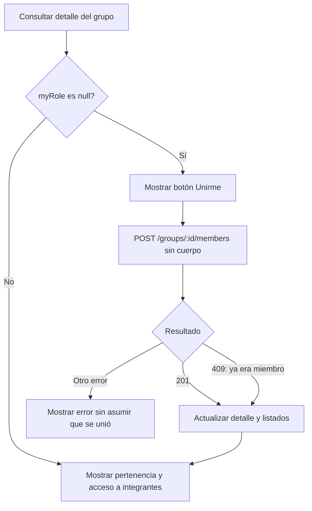

# Blog Backend

API REST con NestJS, Prisma y PostgreSQL. Autenticacion mediante una cookie HttpOnly llamada `jwt`.

## Arranque local

```bash
npm install
npm run start:dev
```

Necesitas PostgreSQL disponible y las variables de conexion de tu `.env` configuradas: `DATABASE_URL`, `DB_USERNAME`, `DB_NAME`, `DB_PASSWORD` y `PG_PORT`. Tambien se requiere `JWT_SECRET`.

Para trabajar con el frontend, configura estas variables en `.env`:

```dotenv
NODE_ENV=development
PORT=4000
FRONTEND_URL=http://localhost:3000
```

Los ejemplos usan `http://localhost:4000/api/v1`. Sustituye `4000` por el valor real de `PORT` en tu `.env`. Si `PORT` no esta definido, Joi aplica `2000`. Reinicia el backend tras modificar `.env`; el watcher de TypeScript no garantiza recargar ese archivo.

`FRONTEND_URL` debe coincidir con el origen del frontend, incluido su puerto. Usa `localhost` de forma consistente: no mezcles `localhost` y `127.0.0.1`.

## Despliegue en Heroku

El archivo `Procfile` debe llamarse exactamente `Procfile`, sin extension y con la `P` en mayuscula. Su contenido inicia la version compilada de Nest:

```text
web: npm run start:prod
```

Heroku ejecuta `npm run build` durante el despliegue porque existe ese script en `package.json`. Configura en Heroku al menos `DATABASE_URL`, `JWT_SECRET`, `FRONTEND_URL` y `NODE_ENV=production` como variables de configuracion. Si agregas Heroku Postgres, `DATABASE_URL` se crea automaticamente.

Antes de iniciar la aplicacion, aplica las migraciones de produccion desde la consola de Heroku:

```bash
npx prisma migrate deploy
```

No uses `.env` en Heroku; las variables se configuran en `Settings > Config Vars`.

## Contrato en inglés y permisos

Las rutas, campos JSON, filtros, roles y errores públicos de auth, categorías y grupos usan inglés. Las tablas, columnas y enums de Prisma conservan sus nombres existentes: la API traduce sus resultados sin migrar los datos. El contenido escrito por usuarios no se traduce.

**Cambio incompatible:** actualizar las peticiones de Postman y frontend. Las rutas y campos anteriores en español ya no son válidos. La documentación explicativa sigue en español.

| Elemento | Contrato actual |
| --- | --- |
| Miembros | `/groups/:id/members` |
| Transferencia | `/groups/:id/transfer` |
| Roles del grupo | `member`, `moderator`, `administrator` |
| Campos de transferencia | `newAdministratorId`, `leave` |
| Crear grupo | `name`, `categoryId`, `description` |
| Filtros | `q`, `categoryId`, `mine`, `cursor`, `limit` |
| Estado del grupo | `myRole`, `_count.members` |
| Perfil de auth | `role: user / administrator`, `status: active / suspended` |

Para diagnosticar un 403, consultar `GET /auth/me` y `GET /groups/ID_DEL_GRUPO` con **la misma cookie** usada para modificar el grupo:

- `/auth/me` devuelve el rol global en `role`.
- El detalle del grupo devuelve tu rol local en `myRole`.
- Cambiar roles exige ser administrador global o del grupo. Transferir exige `myRole: "administrator"`; ser administrador solo global o de otro grupo no basta.
- Después de transferir con `leave: false`, quien transfiere queda como `member` y ya no puede volver a transferir. Con `leave: true`, sale del grupo.
- El ID de la URL es el **grupo**; el ID del cuerpo es **otro usuario que ya pertenece**. No escribir `:id` literalmente.
- Un 400 de `role` indica un campo o valor inválido, no un problema de permisos.

Ejemplo: si el grupo es 12 y el destinatario es el usuario 3, enviar con la cookie del administrador:

```http
POST http://localhost:4000/api/v1/groups/12/transfer
Content-Type: application/json
```

```json
{ "newAdministratorId": "3", "leave": false }
```

Para cambiar el rol del usuario 3:

```http
PATCH http://localhost:4000/api/v1/groups/12/members/3
Content-Type: application/json
```

```json
{ "role": "moderator" }
```

Transferir devuelve 204 sin cuerpo; cambiar rol devuelve 200 con la membresía actualizada.

## Errores de validación: cómo corregir la petición

Los errores 400 de validación incluyen `message` (lista de mensajes) y `details` (errores por campo). Por ejemplo, enviar `{}` a `POST /groups/12/transfer`, con una sesión autorizada, devuelve:

```json
{
  "statusCode": 400,
  "error": "Bad Request",
  "message": [
    "newAdministratorId is required and cannot be null.",
    "leave is required and cannot be null."
  ],
  "details": [
    {
      "field": "newAdministratorId",
      "code": "required",
      "messages": ["newAdministratorId is required and cannot be null."]
    },
    {
      "field": "leave",
      "code": "required",
      "messages": ["leave is required and cannot be null."]
    }
  ]
}
```

| Código en `details` | Significado | Qué corregir |
| --- | --- | --- |
| `required` | Falta un campo obligatorio o llegó como null | Enviar el campo indicado |
| `unknown_field` | El DTO no acepta ese nombre | Revisar nombres; por ejemplo, usar `role`, no `rol` |
| `invalid_value` | El campo o parámetro no cumple la validación | Consultar `messages` para ver tipo, valores permitidos o límites |

Para `role`, se indican los valores `member`, `moderator`, `administrator`. Para `leave`, enviar `true` o `false` sin comillas. Los IDs inválidos de la URL identifican el parámetro `id` o `userId`; reemplazar los marcadores por IDs reales. Si se omite un segmento entero de la URL, puede no existir una ruta coincidente y responder 404.

El frontend puede mostrar `details[].messages` junto a cada campo. Si no hay `details`, usar `message`: los errores de negocio, permisos o JSON mal formado no necesariamente tienen errores por campo. Los guards comprueban permisos antes que los DTO; una sesión sin permiso puede recibir 403 antes de recibir detalles de validación.

## Guía de endpoints para el frontend

Base local: **`http://localhost:4000/api/v1`**. Las rutas de las tablas son relativas a esta base.

> La ruta actual es **`/groups`**, no `/grupos`. `:id` es el ID del grupo y `:userId` es el ID del integrante. Sustituye esos parámetros por valores reales; `me` se escribe literalmente.

### Estado de la API

| Acción | Método y ruta | Sesión | Respuesta |
| --- | --- | --- | --- |
| Comprobar que la API responde | GET (base, sin ruta adicional) | No | 200, texto `Hello World!` |

### Autenticación y cuenta

| Acción en la interfaz | Método y ruta | Sesión | Respuesta |
| --- | --- | --- | --- |
| Registrarse | POST `/auth/register` | No | 201, perfil; no inicia sesión |
| Iniciar sesión | POST `/auth/login` | No | 200, perfil y cookie `jwt` |
| Ver mi perfil | GET `/auth/me` | Sí | 200, perfil |
| Cerrar sesión | POST `/auth/logout` | No obligatoria | 204, elimina la cookie |
| Solicitar recuperación | POST `/auth/forgot-password` | No | 202, mensaje genérico |
| Restablecer contraseña | POST `/auth/reset-password` | No | 204, sin cuerpo |

### Catálogo y exploración de grupos

| Acción en la interfaz | Método y ruta | Sesión | Respuesta |
| --- | --- | --- | --- |
| Cargar selector de categorías | GET `/categories` | No | 200, array de categorías |
| Explorar grupos | GET `/groups` | Sí | 200, `items` y `nextCursor` |
| Ver mis grupos | GET `/groups?mine=true` | Sí | 200, mismo listado filtrado |
| Crear grupo | POST `/groups` | Sí | 201, grupo; el creador ya es administrador |
| Abrir detalle | GET `/groups/:id` | Sí, sin exigir membresía | 200, grupo, conteo, `myRole` y administradores |

### Mi participación e integrantes

| Acción en la interfaz | Método y ruta | Requisito | Respuesta |
| --- | --- | --- | --- |
| **Unirme al grupo** | POST `/groups/:id/members` | Sesión; aún no pertenecer | 201, mi nueva membresía |
| **Salir del grupo** | DELETE `/groups/:id/members/me` | Ser miembro; no ser el último administrador | 204, sin cuerpo |
| Ver integrantes | GET `/groups/:id/members` | Ser miembro, también para admin global | 200, integrantes paginados |

### Administración de integrantes

| Acción en la interfaz | Método y ruta | Requisito | Respuesta |
| --- | --- | --- | --- |
| Cambiar rol | PATCH `/groups/:id/members/:userId` | Administrador del grupo o global | 200, membresía actualizada |
| Expulsar integrante | DELETE `/groups/:id/members/:userId` | Administrador del grupo o global | 204, sin cuerpo |
| Transferir administración | POST `/groups/:id/transfer` | Administrador actual de ese grupo | 204, sin cuerpo |

No hay endpoints para editar o eliminar el grupo, invitar a otro usuario ni aprobar solicitudes de ingreso. Unirse crea la membresía inmediatamente. Ninguna operación permite dejar al grupo sin administrador.

### Reglas comunes de integración

- Enviar `credentials: 'include'` para que el navegador conserve y envíe la cookie. No se usa Bearer token.
- Para cuerpos JSON, enviar `Content-Type: application/json`. Los campos adicionales a los DTO se rechazan con 400 en las operaciones que validan un DTO.
- Las respuestas 204 no tienen cuerpo: no llamar a `response.json()` en ellas.
- Los IDs de categorías y grupos se devuelven como strings. Conservarlos así, sin convertirlos a `Number`.
- 400: entrada inválida; 401: sesión ausente o inválida; 403: acceso denegado; 404: recurso no encontrado; 409: conflicto con el estado actual. Cada operación detalla sus casos.

## Autenticación: ejemplos y respuestas

### Registro

`POST /api/v1/auth/register`

```json
{
  "firstName": "Ana",
  "lastName": "Perez",
  "email": "ana@example.com",
  "password": "ExamplePassword123!"
}
```

- `firstName` y `lastName`: entre 2 y 80 caracteres.
- `email`: correo valido, hasta 254 caracteres. Se almacena en minusculas.
- `password`: de 8 a 72 caracteres, con mayuscula, numero y simbolo; no puede superar 72 bytes UTF-8.
- 409 si el correo ya esta registrado; 400 si los datos no son validos.
- No inicia sesion automaticamente ni establece una cookie.

Respuesta 201 (ejemplo):

```json
{
  "id": 1,
  "firstName": "Ana",
  "lastName": "Perez",
  "email": "ana@example.com",
  "role": "user",
  "status": "active",
  "photoUrl": null
}
```

Este mismo formato se devuelve en login y `/me`. Los nombres de propiedades estan en ingles; los valores de los enums se traducen en la API: `user` / `administrator` y `active` / `suspended`. En auth los IDs se serializan como numeros en JSON; categorías y grupos devuelven sus IDs como strings decimales para preservar la precisión de BigInt. Nunca se devuelve el hash de la contrasena.

### Login

`POST /api/v1/auth/login`

```json
{
  "email": "ana@example.com",
  "password": "ExamplePassword123!"
}
```

Devuelve 200 con el perfil y establece la cookie `jwt` durante una hora. El JWT no se devuelve en el JSON.

- 401: credenciales incorrectas.
- 403: cuenta suspendida, despues de verificar la contrasena.
- 400: cuerpo invalido.

### Perfil actual

`GET /api/v1/auth/me`

Sin cuerpo. El navegador debe enviar la cookie con `credentials: 'include'`.

Devuelve 200 con el perfil. Devuelve 401 si falta la cookie, el JWT no es valido, ha expirado o el usuario ya no existe; 403 si la cuenta esta suspendida.

No se admite `Authorization: Bearer` como alternativa a la cookie.

### Logout

`POST /api/v1/auth/logout`

Sin cuerpo. Devuelve 204 y elimina la cookie; no intentes leer JSON de esta respuesta. Utiliza `credentials: 'include'`.

Elimina la cookie del navegador, pero no revoca copias del JWT que pudieran existir.

### Solicitar recuperacion de contrasena

`POST /api/v1/auth/forgot-password`

```json
{
  "email": "ana@example.com"
}
```

Respuesta 202:

```json
{
  "message": "If the account exists, password reset instructions will be provided."
}
```

La respuesta es igual para correos existentes e inexistentes. No requiere cookie ni devuelve el token.

Para una cuenta existente, se invalidan los tokens anteriores y se genera uno nuevo con vigencia de 30 minutos. La BD guarda solamente su hash SHA-256.

#### Obtener el token en desarrollo

1. Asegurate de tener `NODE_ENV=development` en `.env`.
2. Reinicia `npm run start:dev` si acabas de cambiar esa variable.
3. Solicita recuperacion con un correo que ya hayas registrado.
4. Mira la terminal donde se ejecuta Nest, no la consola del navegador.
5. Copia el valor que aparece despues de:

```text
[AuthService] Password reset token (development only):
```

El token real tiene 43 caracteres. No copies el prefijo del mensaje, ni el hash de la BD, ni el JWT de la cookie.

Si el correo no existe, no se genera ni se imprime un token, aunque la respuesta sea 202. Si haces otra solicitud, utiliza el ultimo token generado.

El envio de correo todavia no esta implementado. En produccion el token no se imprime: configura `NODE_ENV=production` y conecta un servicio de correo antes de ofrecer recuperacion a usuarios reales.

### Restablecer contrasena

`POST /api/v1/auth/reset-password`

```json
{
  "token": "REEMPLAZAR_POR_EL_TOKEN_REAL_DE_43_CARACTERES",
  "newPassword": "NewExamplePassword456!"
}
```

El texto de ejemplo de `token` debe reemplazarse por el token real de la terminal.

- `token`: string de exactamente 43 caracteres.
- `newPassword`: las mismas reglas de seguridad que la contrasena de registro.
- 204: contrasena actualizada y token consumido, sin cuerpo.
- 400: token ausente, longitud incorrecta o contrasena invalida.
- 410: token inexistente, expirado, invalidado o ya utilizado.

No requiere una sesion iniciada. El token de recuperacion se envia en el JSON, no en una cookie. Despues, haz login con la nueva contrasena. Restablecerla no inicia sesion ni invalida automaticamente los JWT emitidos previamente.


### Cookies en el navegador

El navegador gestiona la cookie automaticamente. Al ser HttpOnly, no puedes leerla con `document.cookie` y no necesitas guardar el JWT en localStorage.

La cookie usa `SameSite=Strict`, `Path=/` y `Secure` cuando `NODE_ENV=production`. Para cookies entre origenes distintos, frontend y API deben pertenecer al mismo sitio; habilitar CORS no permite enviar esta cookie entre sitios distintos. En local puedes usar `http://localhost:3000` y `http://localhost:4000`.

## Secuencia sugerida para integrar el frontend

1. Crear una cuenta con `register`.
2. Iniciar sesion con `login`.
3. Recuperar el perfil mediante `me`, tambien al recargar la pagina.
4. Cerrar sesion con `logout`.
5. Solicitar recuperacion con `forgot-password`.
6. Copiar el token de la terminal y enviarlo con `newPassword` a `reset-password`.
7. Iniciar sesion con la nueva contrasena.


## Categorías y grupos de estudio

La ruta del catálogo es `/categories` (en inglés); las de grupos son `/groups`, con `/members` y `/transfer` también en inglés. Todas llevan el prefijo `/api/v1`. Solo categorías es pública; grupos requiere la cookie `jwt` obtenida en login, no un Bearer token.

Los IDs de estas respuestas son strings, por ejemplo `"12"`. Envía también `categoryId` e `newAdministratorId` como strings decimales positivos para admitir todo el rango hasta `9223372036854775807`. Se aceptan números JSON únicamente si son enteros positivos seguros (hasta `Number.MAX_SAFE_INTEGER`). No conviertas los IDs de respuesta a `Number`.

### Catálogo: GET /api/v1/categories

Sin cuerpo ni parámetros. Devuelve un array con `categoryId`, `name` y `description` (string o null), ordenado por nombre. El resultado se conserva en caché durante una hora por instancia. Al iniciar, si la tabla está vacía, se crean Cálculo I, Programación II, Bases de Datos, Física General, Estadística e Ingeniería de Software. Usa los IDs reales del catálogo; no asumas que empiezan en 1.

## Grupos: crear y explorar

### Crear: POST /api/v1/groups

`name` debe tener de 3 a 100 caracteres; `description` es opcional, hasta 1000 caracteres. La categoría debe existir.

```json
{
  "name": "Grupo de Cálculo",
  "categoryId": "1",
  "description": "Repaso de límites y derivadas"
}
```

Devuelve el grupo con `groupId`, `categoryId`, `creatorId`, `name`, `description`, `createdAt`, `category`, `_count.members` y `myRole: "administrator"`. El creador ya queda inscrito: no debe llamar a unirse otra vez. No existe un endpoint de edición o eliminación del grupo.

### Listar: GET /api/v1/groups

Todos los filtros son opcionales:

| Parámetro | Valor y comportamiento |
| --- | --- |
| `q` | Busca por nombre, sin distinguir mayúsculas. |
| `categoryId` | ID decimal de la categoría. |
| `mine` | `true`: solo grupos donde perteneces. `false` u omitido: todos los grupos que cumplen los demás filtros, incluidos los tuyos. |
| `cursor` | Copia el `nextCursor` de la página anterior. |
| `limit` | Entero de 1 a 50; por defecto 30. |

Ejemplo: `GET /api/v1/groups?q=calculo&categoryId=1&mine=false&limit=10`.

La respuesta es `{ "items": [...], "nextCursor": "12" }`. Cuando no hay más resultados, `nextCursor` es null. Los grupos están ordenados por `groupId` descendente. Cada elemento incluye categoría, conteo de miembros y `myRole` (`member`, `moderator`, `administrator` o null). Para la siguiente página, conserva los filtros y agrega `cursor`; no uses un número de página.

### Detalle: GET /api/v1/groups/:id

Sin cuerpo. Devuelve los mismos campos del grupo y `administrators`, un array con `userId`, `name`, `lastName` y `photoUrl`. No necesitas pertenecer al grupo para consultar su detalle, pero sí iniciar sesión. Si no existe, devuelve 404.

## Cómo se calcula el total de miembros

**No falta una columna en la BD.** El total es un dato calculado a partir de las membresías existentes.

| Tabla | Qué guarda | Ejemplo |
| --- | --- | --- |
| `grupo_estudio` | Datos del grupo | Grupo 12: Cálculo |
| `user` | Datos de cada persona | Usuario 5: Ana |
| `miembro_grupo` | Una fila por persona que pertenece a un grupo, con rol y fecha | Grupo 12 + usuario 5 + administrador |

Ejemplo ilustrativo de `miembro_grupo`:

| id_grupo | id_usuario | rol |
| --- | --- | --- |
| 12 | 5 | administrador |
| 12 | 8 | miembro |
| 12 | 9 | moderador |
| 20 | 8 | miembro |

El grupo **12 tiene 3 miembros** y el grupo **20 tiene 1**. Se cuentan todos los roles, incluidos administradores y moderadores. Una persona puede pertenecer a varios grupos. La clave compuesta `(id_grupo, id_usuario)` evita duplicar a una persona dentro del mismo grupo.

En `src/groups/groups.repository.ts`, la selección compartida del grupo contiene:

```ts
_count: { select: { miembros: true } }
```

Esto solicita a Prisma el conteo de la relación; `_count` no es una columna ni una tabla. Conceptualmente, para el grupo 12 equivale a:

```sql
SELECT COUNT(*) FROM miembro_grupo WHERE id_grupo = 12;
```

El conteo aparece en crear grupo, listar grupos y consultar su detalle. **No hay un endpoint separado dedicado al conteo.** Fragmento ilustrativo de un grupo en la respuesta:

```json
{
  "groupId": "12",
  "name": "Grupo de Cálculo",
  "_count": { "members": 3 },
  "myRole": null
}
```

Para una tarjeta, usar `grupo._count.members`. `myRole: null` significa que el usuario de la sesión no pertenece al grupo; el total incluye a las demás personas.

### Qué cambia en cada operación

| Operación exitosa | Cambio en las membresías | Cambio en el total |
| --- | --- | --- |
| Crear grupo | Se crea la membresía del creador como administrador | El grupo comienza con 1 |
| Unirme | Se agrega mi fila | +1 |
| Salir o ser expulsado | Se elimina la fila correspondiente | −1 |
| Cambiar un rol | Se modifica el rol, sin agregar filas | Sin cambio |
| Transferir con `leave: false` | Cambian los roles de dos miembros existentes | Sin cambio |
| Transferir con `leave: true` | Cambian roles y se elimina al administrador saliente | −1 |
| Intentar unirme otra vez | Se rechaza con 409 | Sin cambio |

No almacenar otro contador evita tener que sincronizar dos datos cada vez que alguien entra o sale. El conteo se obtiene al consultar; una respuesta ya recibida en el navegador no se actualiza sola. Después de una operación exitosa, volver a consultar el detalle y actualizar o invalidar el listado de grupos y de integrantes que muestre la interfaz.

**No usar `items.length` del listado de integrantes como total del grupo:** esa lista está paginada y puede estar filtrada por búsqueda. Tampoco contar solo a los usuarios cuyo rol es `member`.

## Membresías: unirse, salir y consultar integrantes

### Unirse: POST /api/v1/groups/:id/members

Sin cuerpo. Inscribe al usuario de la sesión como `member`; no recibe un ID de otro usuario. Devuelve 201 con `groupId`, `userId`, `role` y `joinedAt`. Si ya perteneces, devuelve 409: `You are already a member of this group`.

#### Flujo del botón «Unirme»



Ejemplo: la persona autenticada quiere entrar al grupo `12`.

```http
POST http://localhost:4000/api/v1/groups/12/members
Cookie: jwt=<cookie gestionada por el navegador o Postman>
```

**Body: ninguno.** No enviar `userId`, `role` ni `categoryId`. El usuario se obtiene de la cookie, el grupo de la URL y el rol inicial es `member`. Esto agrega a la persona al grupo; abrir su pantalla sin unirse corresponde a `GET /groups/12`.

Respuesta 201 ilustrativa:

```json
{
  "groupId": "12",
  "userId": "8",
  "role": "member",
  "joinedAt": "2026-11-04T18:00:00.000Z"
}
```

Esta respuesta es una **membresía**, no el detalle del grupo, por lo que no incluye `_count`.

Ejemplo para el frontend, después de iniciar sesión:

```js
const base = 'http://localhost:4000/api/v1';
const idGrupo = '12'; // Usar el ID real seleccionado.
const respuesta = await fetch(base + '/groups/' + idGrupo + '/members', {
  method: 'POST',
  credentials: 'include',
});

// 409 en esta operación significa que ya pertenecemos al grupo.
if (!respuesta.ok && respuesta.status !== 409) {
  const error = await respuesta.json();
  throw new Error([error.message].flat().join(', '));
}

const detalle = await fetch(base + '/groups/' + idGrupo, {
  credentials: 'include',
});
if (!detalle.ok) throw new Error('No se pudo actualizar el grupo');
const grupo = await detalle.json();
// Actualizar el estado de la pantalla con estos valores:
console.log(grupo.myRole, grupo._count.members);
```

### Salir: DELETE /api/v1/groups/:id/members/me

Sin cuerpo. `me` se escribe literalmente. Devuelve 204 sin cuerpo, o 404 si no tienes membresía. Si eres el único administrador, devuelve 409: `You are the only administrator; transfer administration before leaving`.

### Integrantes: GET /api/v1/groups/:id/members

Requiere membresía efectiva, incluso para un administrador global. Acepta `q` (nombre, apellido o correo), `cursor` y `limit` (1–50, por defecto 30). Devuelve `{ "items": [...], "nextCursor": null }`, con cursor string cuando hay otra página, ordenado por ID de usuario descendente.

Cada elemento contiene `role`, `joinedAt` y `user`. Este último incluye únicamente `userId`, `name`, `lastName`, `email`, `major` y `photoUrl`. Utiliza `user.userId` como `:userId` en las operaciones siguientes.

## Administración: roles, expulsión y transferencia

### Cambiar rol: PATCH /api/v1/groups/:id/members/:userId

Requiere administrador del grupo o global. Cuerpo:

```json
{ "role": "moderator" }
```

Valores válidos: `member`, `moderator`, `administrator`. Devuelve 200 con la membresía actualizada. Un moderador no puede cambiar roles ni expulsar integrantes. Devuelve 404 si el integrante no existe y 409 si intentas degradar al último administrador.

### Expulsar: DELETE /api/v1/groups/:id/members/:userId

Sin cuerpo. Requiere administrador del grupo o global. Devuelve 204 sin cuerpo. No permite expulsar al último administrador, ni siquiera a uno mismo: devuelve 409, `The group must have at least one administrator`.

### Transferir: POST /api/v1/groups/:id/transfer

```json
{
  "newAdministratorId": "2",
  "leave": false
}
```

El destinatario debe ser otro miembro del grupo. `leave` es obligatorio y debe ser booleano, no el string `"false"`. Con false, el administrador actual queda como miembro; con true, sale del grupo. Devuelve 204 sin cuerpo. Transferirse a uno mismo o a un usuario sin membresía devuelve 400. Un administrador global que no sea administrador actual de ese grupo no puede transferir: recibe 403.

## Prueba completa desde PowerShell

Inicia primero el backend. Ejecuta estos bloques en orden en la misma terminal PowerShell. Ajusta el puerto al de tu servidor; para Heroku, usa `https://TU-APP.herokuapp.com/api/v1`. Las sesiones guardan las cookies en memoria. También puedes usar Postman: haz login y conserva su cookie jar para el mismo host.

Estos ejemplos crean dos cuentas y un grupo persistentes en la base configurada. Utiliza una base de desarrollo para esta prueba manual; no hay endpoint para borrar el grupo.

```powershell
$base = 'http://localhost:4000/api/v1'
$suffix = [guid]::NewGuid().ToString('N')
$emailAdmin = "admin-$suffix@example.com"
$emailMiembro = "miembro-$suffix@example.com"
$passwordPrueba = 'ExamplePassword123!'

# Registrar dos cuentas; el registro no inicia sesión.
foreach ($email in @($emailAdmin, $emailMiembro)) {
  $body = @{ firstName = 'Usuario'; lastName = 'Prueba'; email = $email; password = $passwordPrueba } | ConvertTo-Json
  Invoke-RestMethod -Method Post -Uri "$base/auth/register" -ContentType 'application/json' -Body $body
}

# Dos sesiones independientes: cada una conserva su propia cookie jwt.
$body = @{ email = $emailAdmin; password = $passwordPrueba } | ConvertTo-Json
Invoke-RestMethod -Method Post -Uri "$base/auth/login" -ContentType 'application/json' -Body $body -SessionVariable sesionAdmin
$body = @{ email = $emailMiembro; password = $passwordPrueba } | ConvertTo-Json
Invoke-RestMethod -Method Post -Uri "$base/auth/login" -ContentType 'application/json' -Body $body -SessionVariable sesionMiembro

# GET categories: público. Elegir un ID real.
$categorias = Invoke-RestMethod -Uri "$base/categories"
$categorias | Format-Table
$idCategoria = [string]$categorias[0].categoryId

# POST grupos: el creador queda como administrador.
$body = @{ name = 'Grupo de prueba'; categoryId = $idCategoria; description = 'Ejemplo desde PowerShell' } | ConvertTo-Json
$grupo = Invoke-RestMethod -Method Post -Uri "$base/groups" -WebSession $sesionAdmin -ContentType 'application/json' -Body $body
$idGrupo = [string]$grupo.groupId
$grupo | ConvertTo-Json -Depth 6

# GET listado y detalle.
$pagina = Invoke-RestMethod -Uri "$base/groups?categoryId=$idCategoria&mine=false&limit=10" -WebSession $sesionAdmin
$pagina | ConvertTo-Json -Depth 6
if ($pagina.nextCursor) {
  Invoke-RestMethod -Uri "$base/groups?categoryId=$idCategoria&mine=false&limit=10&cursor=$($pagina.nextCursor)" -WebSession $sesionAdmin
}
Invoke-RestMethod -Uri "$base/groups/$idGrupo" -WebSession $sesionAdmin

# POST miembros: la segunda cuenta se une. Guardar su ID exacto.
$membresia = Invoke-RestMethod -Method Post -Uri "$base/groups/$idGrupo/members" -WebSession $sesionMiembro
$idMiembro = [string]$membresia.userId

# GET miembros y PATCH rol.
Invoke-RestMethod -Uri "$base/groups/$idGrupo/members?limit=30" -WebSession $sesionAdmin
$body = @{ role = 'moderator' } | ConvertTo-Json
Invoke-RestMethod -Method Patch -Uri "$base/groups/$idGrupo/members/$idMiembro" -WebSession $sesionAdmin -ContentType 'application/json' -Body $body

# DELETE miembro: expulsar a la segunda cuenta (204).
Invoke-RestMethod -Method Delete -Uri "$base/groups/$idGrupo/members/$idMiembro" -WebSession $sesionAdmin

# Volver a unirse para probar la transferencia.
Invoke-RestMethod -Method Post -Uri "$base/groups/$idGrupo/members" -WebSession $sesionMiembro

# POST transferencia: la segunda cuenta pasa a administrar; la primera queda como miembro (204).
$body = @{ newAdministratorId = $idMiembro; leave = $false } | ConvertTo-Json
Invoke-RestMethod -Method Post -Uri "$base/groups/$idGrupo/transfer" -WebSession $sesionAdmin -ContentType 'application/json' -Body $body

# DELETE me: la primera cuenta ya puede salir; queda la segunda como administrador (204).
Invoke-RestMethod -Method Delete -Uri "$base/groups/$idGrupo/members/me" -WebSession $sesionAdmin
Invoke-RestMethod -Uri "$base/groups/$idGrupo" -WebSession $sesionMiembro
```

Las operaciones 204 no imprimen JSON. Los errores HTTP hacen que `Invoke-RestMethod` lance una excepción; consulta el cuerpo de error en la terminal o en Postman.

### Errores que puedes comprobar

| Prueba | Resultado esperado |
| --- | --- |
| Consultar grupos sin cookie válida | 401 |
| Crear grupo con nombre de 2 caracteres, ID inválido o campos adicionales | 400 |
| Usar `mine=otro` o `limit=51` | 400 |
| Crear grupo con categoría inexistente | 404 |
| Unirse dos veces al mismo grupo | 409 |
| Consultar integrantes sin membresía | 403 |
| Cambiar roles o expulsar como miembro/moderador | 403 |
| Salir, degradar o expulsar al único administrador | 409 |
| Transferir a uno mismo o a un usuario que no pertenece al grupo | 400 |

### Verificación contra la base de datos

Ejecuta primero `npm run build`. El script verifica roles, transferencia, permisos y respuestas en inglés con datos temporales que se revierten al terminar. Requiere PostgreSQL.

```powershell
$env:RUN_REMOTE_SMOKE = '1'
try {
  node src/groups/verification/remote-smoke.cjs
} finally {
  Remove-Item Env:RUN_REMOTE_SMOKE -ErrorAction SilentlyContinue
}
```

## Compilar

```bash
npm run build
```
